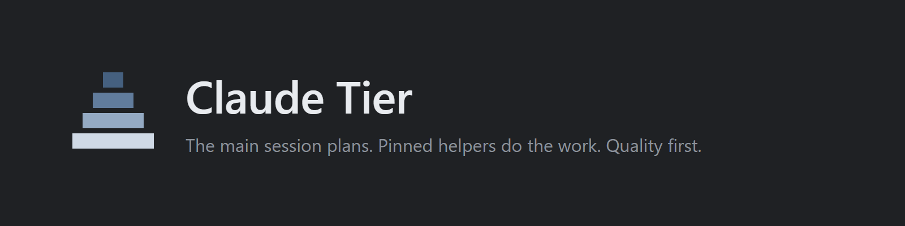
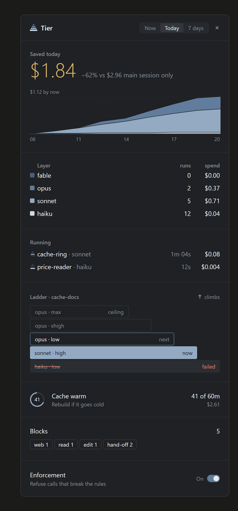
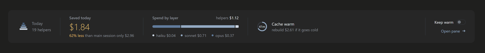
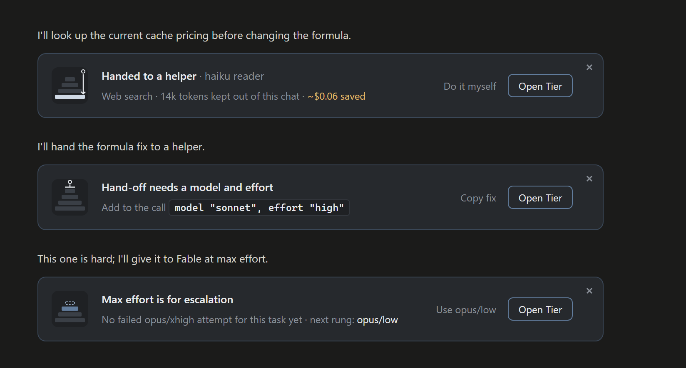
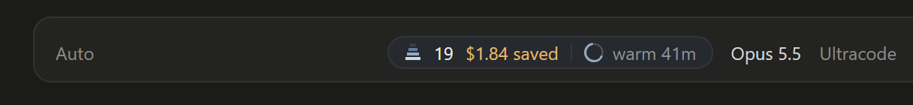
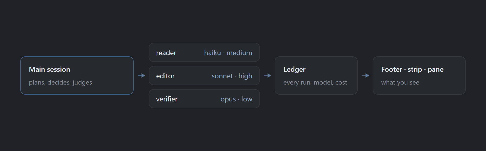

# Claude Tier + Codex Tier

Quality-first model and effort routing for Claude Code and OpenAI Codex.

Two small, independent routers that cut model spend without lowering quality.
They install separately, share no routing logic, and each ships its own guide,
changelog, and installers.

| | Claude Tier | Codex Tier |
| --- | --- | --- |
| Runs in | Claude Code | Codex |
| What it does | A rule that routes each piece of work to a pinned model and effort, plus an optional mod that enforces it and shows the cost | Routes each work unit to a tool, the current session, or a pinned model x reasoning-effort worker, then verifies |
| Invoke | `/tier` | `$codex-tier` |
| Guide | [docs/claude-tier](docs/claude-tier/README.md) | [docs/codex-tier](docs/codex-tier/README.md) |
| Changelog | [CHANGELOG](docs/claude-tier/CHANGELOG.md) | [CHANGELOG](docs/codex-tier/CHANGELOG.md) |

Installable versions are on the [releases page](https://github.com/thephenyl02-creator/claude-codex-tier/releases).
Each product owns its own directories: Claude Tier in `skills/tier/`,
`plugins/tier-mod/` and `docs/claude-tier/`; Codex Tier in `plugins/codex-tier/`, `docs/codex-tier/`,
`tests/codex-tier/`, and `benchmarks/codex-tier-e2e/`. The four `install*`
scripts at the root are the installers.

## Claude Tier

<p align="center">
  
</p>

Claude Tier keeps the expensive model for planning and judging, and sends
the rest of the work to helpers on the cheapest model that still does it
right. It has two parts. The `tier` plugin writes one rule into your
project, and the model reads it every turn. The optional Tier mod makes
Claude Code hold to that rule and shows what each hand-off cost and saved.
Quality comes first: when in doubt, the rule does not downgrade.

### Install

One command installs Claude Code if it is missing, adds both plugins, and
falls back to a plain skill copy when the plugin route is blocked. A failed
mod install never blocks the rule. Safe to re-run.

macOS / Linux / WSL:

```bash
curl -fsSL https://raw.githubusercontent.com/thephenyl02-creator/claude-codex-tier/main/install.sh | bash
```

Windows PowerShell:

```powershell
irm https://raw.githubusercontent.com/thephenyl02-creator/claude-codex-tier/main/install.ps1 | iex
```

Already have Claude Code? Add the marketplace, then the two plugins:

```
claude plugin marketplace add thephenyl02-creator/claude-codex-tier
claude plugin install tier@claude-tier
claude plugin install tier-mod@claude-tier
```

Then, in any project, run `/tier`. The rule lands in a machine-local
`CLAUDE.local.md`, so your repo stays clean; `/tier repo` writes the committed
`CLAUDE.md` instead, which also covers web and mobile sessions. The mod is
optional. It runs in the desktop app, the terminal and VS Code, and was built
on Claude Code 2.1.308.

### Requirements, removal, privacy

The rule works in any Claude Code. The mod needs Claude Code 2.1.308 or newer
in every Claude Code you use: the desktop app and the terminal `claude`, which
can be older than the app (check with `claude --version`).

To remove it, run `claude plugin uninstall tier-mod@claude-tier` and
`claude plugin uninstall tier@claude-tier`, then delete the
`<!-- tier-rule ... -->` block from `CLAUDE.local.md` / `CLAUDE.md`.

What the mod writes: the ledger and its switches live in Claude Code's plugin
store under `~/.claude/plugins`, plus a status file at
`~/.claude/tier-mod-status.json`. What it sends: nothing leaves your machine
except keep-warm pings, which are ordinary model requests on your own account.

### What you see

These images are rendered from the design file. The figures in them are
illustrative, not measurements.

<p align="center">
  
</p>

The side pane: savings, spend by layer, running helpers, the escalation
ladder, the cache, blocks and the enforcement switch.



The hover strip above the prompt: helpers today, savings, spend by layer,
the cache ring and Keep warm.



When Tier steps in: work sent down to a helper, a hand-off missing its model
and effort, or max effort held back.



The footer pill next to the session model: helper count, savings and the
cache ring.

### How it works



The main session plans, decides and judges. Readers, editors and verifiers
do the work, each pinned to a model and an effort. Every hand-off goes into
a ledger, and the footer, strip and pane read from it.

### Measured

| What | Result | n |
| --- | --- | --- |
| Opus 5.5 quality at every effort | no misses | part of 429 graded runs (3 models x 5 efforts, 3 tasks, at least 5 runs per setting, 2026-10-24) |
| Sonnet 5.5 on a silent bug hunt | one miss each at low and medium, clean from high | same runs |
| Sonnet/high vs Opus/low, cost per run | about 0.7x at equal quality | 3 tasks |
| Helper boot, listed tools vs every tool | ~10K vs ~55K tokens | one machine (2026-10-24) |
| Model switch mid-session | 20x the cost of the same turn | one turn plus a control, on Opus 5 |
| Three days of building Tier with Tier | $95.26 saved against $140.04 main-only | 51 hand-offs (2026-10-24 to 10-26), one user, estimate |

The saving is a counterfactual estimate and includes test runs. Method and
caveats for every row are in the guide's
[Measurements](docs/claude-tier/README.md#measurements) section.

Read the [guide](docs/claude-tier/README.md) for the full rule, the Tier mod,
every install path and troubleshooting. Release history is in the
[changelog](docs/claude-tier/CHANGELOG.md).

## Codex Tier

Needs Codex already installed (`npm install --global @openai/codex`). The
installer detects the CLI or the Windows app, prefers the plugin marketplace,
and falls back to a standalone skill copy. Safe to re-run.

macOS / Linux / WSL:

```bash
curl -fsSL https://raw.githubusercontent.com/thephenyl02-creator/claude-codex-tier/main/install-codex.sh | bash
```

Windows PowerShell:

```powershell
irm https://raw.githubusercontent.com/thephenyl02-creator/claude-codex-tier/main/install-codex.ps1 | iex
```

Already have Codex? Two commands:

```
codex plugin marketplace add thephenyl02-creator/claude-codex-tier
codex plugin add codex-tier@codex-tier
```

Then start a new Codex task and begin it with `$codex-tier`. You never pick a
model, effort, worker count, or escalation path: the router chooses the
cheapest calibrated model x reasoning-effort pair expected to meet the
quality bar, verifies the result, and escalates only the affected unit.

Measured on five workloads: a 9.83% median exposed-token reduction versus
always Sol/max at a 100% quality-gate pass rate (13.82% derived for the final
routes). Exposed tokens are not credits, billing, dollars, or quota. The
[guide](docs/codex-tier/README.md) covers architecture, worker enforcement,
configuration, logging, tests, and current limitations; the
[benchmark report](benchmarks/codex-tier-e2e/CONSOLIDATED-BENCHMARK-REPORT.md)
holds the evidence and its limits.

## Feedback

Notes, questions, and measured results go in
[Discussions](https://github.com/thephenyl02-creator/claude-codex-tier/discussions).
Something broken?
[Report a bug](https://github.com/thephenyl02-creator/claude-codex-tier/issues/new?template=bug_report.yml).

## Keywords

Claude Code plugin, Claude Code skill, Claude Code cost optimization, reduce
Claude Code cost, Claude Code model tiering, Opus vs Sonnet routing, model
selection for coding agents, reasoning effort router, sub-agent pinning,
CLAUDE.md working preferences, Codex plugin, Codex skill, Codex model routing,
reduce Codex usage, LLM model routing, AI coding agent cost, quality-first
routing, Opus, Sonnet, Haiku.

## License

MIT (c) Fenil K Ventures LLC
