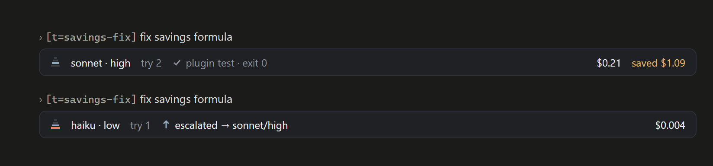

# Claude Tier

> Part of the [Claude Tier + Codex Tier](../../README.md) repository. Release history: [CHANGELOG](CHANGELOG.md).

Claude Tier has two parts.

- **The rule** (`tier` plugin, rule 1.12.0). Run **`/tier`** in any project
  and it installs a standing model/effort-tiering preference for that
  project. By default the rule lands in a machine-local `CLAUDE.local.md`,
  so your repo stays clean; `/tier repo` commits it instead when you want
  web and mobile coverage too. The rule is text the model reads every turn.
  On its own it hooks nothing and calls nothing.
- **The Tier mod** (`tier-mod` plugin, 0.20.0, optional). It runs inside
  Claude Code (desktop app, terminal, VS Code), enforces the rule's limits in
  code, keeps a ledger of every hand-off, and shows cost and savings in the
  footer, a hover strip and a side pane. See [The Tier mod](#the-tier-mod).

## What the rule does

- **Plan and judge on the session's model; execute through pinned
  sub-agents.** The main session's model is frozen at start (the prompt
  cache is keyed by it - switching mid-session measured 20x the cost of the
  same turn; on the 5.5 models and Fable 5.1 an effort change keeps the
  cache), so sub-agents are the tier lever.
- **Fixed limits for the main session, per user message.** Web research
  (including curl and docs CLIs) always goes to a reader helper. Inline
  reading stays within ~8K tokens, and a file of 300+ lines is read only
  with a line range. Inline edits stay within 2 files, and a single Write
  within 150 lines. Bigger work goes to a helper with a model and an
  effort. Saying "do it yourself" lifts the limits for that message.
- **Derives each route from measured facts, not a table:** tests, builds
  and linters run with no model; work a tool will check goes to Haiku at
  low effort; reading and extraction whose cited items a strong model
  spot-checks go to Haiku at medium (inferred from its measured runs); silent work fully determined by its
  input goes to Sonnet at high; judgment, ambiguous specs, verification and
  design default to **Opus at low effort**. Haiku only goes where its
  mistakes get seen. Re-measured on the 5.5 models (429 graded runs,
  2026-10-24); Opus's edge on ambiguous specs was measured on the 5.0
  generation.
- **Model is the strong lever, effort the weak one.** On the 5.5 models,
  high effort cost Sonnet and Opus 1.0-1.6x low and xhigh 1.1-2x; more effort raised
  quality only where the model was at its limit (Haiku at low on silent
  work). Sonnet 5.5's recalibrated levels put agentic edits at medium.
  `max` is never a default (2-9x the cost of low for no measured gain).
- **Checks travel with the hand-off.** When a tool can prove the result,
  the helper runs the check and reports the command and its exit code; no
  model judges it. Pushing stays with the main session.
- **One escalation ladder.** A weak result, an `ESCALATE:` reply or a failed
  check moves the task one rung: haiku -> sonnet/high -> opus/low -> rewrite
  the brief -> opus/xhigh -> opus/max (or fable/high where the plan has
  Fable) -> stop and report. Each hand-off carries a one-word `[t=<task>]`
  tag, so a rung counts against the same task.
- **Fable 5.1 and `max` are escalation only:** after an opus/xhigh failure
  of that `[t=]` task, or when you ask. Measured total cost of Fable ran
  1.4-1.7x Opus 5 at low by task with no quality edge on any shape measured
  (measured on 5.0; Opus 5.5 is cheaper still). Without Fable on the plan,
  Opus at max is the ceiling - the rule never stalls on an unavailable model.
- **Newest model within a tier, always** - same or lower price, better model.
  Today that is Fable 5.1, Opus 5.5, Sonnet 5.5 and Haiku 5.5; the `opus`,
  `sonnet` and `haiku` aliases resolve to the 5.5 models (checked in Claude
  Code on 2026-10-12), so a full model ID is only needed when an alias lags.
- **Every sub-agent is pinned** (model, effort, tools; workflow `agent()`
  calls also name the agent type) and pays a boot cost before any work
  (~10K tokens with a listed toolset, ~55K with every tool), so a helper
  only pays off when the work clears that boot. Independent same-tier
  agents go out in one batch; a pinned-low agent that meets more than its
  brief replies `ESCALATE:` and is re-run one rung up.
- **Cache facts the rule plans around.** The main session's cache lives 1h
  on a subscription within plan, and 5m on usage credits, an API key, cloud
  providers or over the plan limit. Sub-agents always get 5m. Every reply
  re-reads its whole context, and a cache write costs 20x a read on Sonnet
  and Haiku, 40x on Opus and 80x on Fable. A full rebuild happens after
  idling past the TTL or on a model change.
- **Mod or no mod.** A local session where the Tier mod is not running says
  so once ("rule-only mode"); the limits are then advice. In web sessions
  they are always advice.
- **Per-task fit:** *downgrade* clearly mechanical work directly; *upgrade*
  only after saying so.
- **Hard rule that overrides everything: never compromise quality.** Any doubt
  whether a downgrade would hurt = don't downgrade.

## Install

Three paths - pick the one that matches you.

### 1. New to Claude Code? One command sets up everything

Nothing needs to be installed first - not even Claude Code itself.

**macOS / Linux / Ubuntu / WSL** (any bash shell):

```
curl -fsSL https://raw.githubusercontent.com/thephenyl02-creator/claude-codex-tier/main/install.sh | bash
```

**Windows** (PowerShell):

```
irm https://raw.githubusercontent.com/thephenyl02-creator/claude-codex-tier/main/install.ps1 | iex
```

The installer absorbs everything that usually goes wrong on a fresh machine:
it installs the Claude Code CLI if it's missing, works even when `claude`
isn't on your PATH yet, never depends on your git/SSH setup, and if the
plugin route is still blocked it falls back to copying the skill directly
into `~/.claude/skills/` - no git needed at all. It changes nothing outside
its job: your git config and shell session are left exactly as found. Safe to
re-run any time; it updates an existing install. It then adds the Tier mod
on Claude Code 2.1.308 or newer; if that step fails or is skipped, it prints
the manual command and the rule install still counts as done.

### 2. Already have Claude Code? Two commands, plus one for the mod

From any terminal:

```
claude plugin marketplace add thephenyl02-creator/claude-codex-tier
claude plugin install tier@claude-tier
claude plugin install tier-mod@claude-tier   # optional: the Tier mod
```

Or the same thing inside a Claude Code session:

```
/plugin marketplace add thephenyl02-creator/claude-codex-tier
/plugin install tier@claude-tier
```

(Typed `/plugin` commands exist only in the terminal CLI. On the **desktop
app**, click **+** next to the prompt box -> **Plugins** -> **Add plugin** ->
add marketplace `thephenyl02-creator/claude-codex-tier` -> install **tier**,
and **tier-mod** if you want the mod.)

### 3. Plugin authors & the git-averse: fully native, fully git-free

The marketplace can be added straight from its manifest URL, and the plugin
itself ships as a sha256-pinned zip archive - so the whole chain installs
over plain HTTPS, even on machines with no git or SSH configured:

```
claude plugin marketplace add https://raw.githubusercontent.com/thephenyl02-creator/claude-codex-tier/main/.claude-plugin/marketplace.json
claude plugin install tier@claude-tier
```

**Cloud (claude.ai/code):** cloud sessions have no plugin browser - declare
the plugin in the repo's `.claude/settings.json` instead, and it installs at
session start:

```json
{
  "extraKnownMarketplaces": {
    "claude-tier": {
      "source": { "source": "github", "repo": "thephenyl02-creator/claude-codex-tier" }
    }
  },
  "enabledPlugins": { "tier@claude-tier": true }
}
```

(In a cloud session `/tier` will offer to install in repo mode - untracked
local files don't survive there, so durable coverage needs the committed
`CLAUDE.md`.)

Then, in any project:

```
/tier
```

By default the rule lands in the project's `CLAUDE.local.md` - a
machine-local file Claude Code loads right alongside `CLAUDE.md` - and it's
kept out of version control via `.git/info/exclude`, so even your
`.gitignore` stays untouched. **Nothing about your repo changes.** Your
personal routing preference stays yours instead of being pushed onto every
collaborator.

Want the rule on web (claude.ai/code) + mobile too? Those surfaces only read
committed files, so that coverage requires committing it:

```
/tier repo
```

writes the block into the committed `CLAUDE.md` instead (and offers the
commit).

If the project already carries an **older version** of the rule, `/tier`
upgrades the block in place automatically; if it's already current, it skips.
If an old install lives in your committed `CLAUDE.md`, `/tier` offers to
migrate it out to `CLAUDE.local.md`.

Not inside a git repo? `/tier` still works: the rule lands in the current
directory's `CLAUDE.md` as a machine-local install (sessions launched there
load it; web + mobile only read committed repo config).

## Troubleshooting

Every entry below is a real blocker someone hit installing this. The
one-command installer handles all of them automatically - these are the
manual fixes if you're doing it by hand.

- **`command not found: claude`** - the Claude Code CLI isn't installed, or
  it's installed but `~/.local/bin` isn't on your PATH. Install:
  `curl -fsSL https://claude.ai/install.sh | bash`, then follow its PATH note
  (usually `echo 'export PATH="$HOME/.local/bin:$PATH"' >> ~/.zshrc` and open
  a new terminal).
- **`permission denied: ~/.zshrc`** while adding the PATH line - your shell
  profile is owned by root (usually from an old `sudo` mishap). Reclaim it:
  `sudo chown $(whoami) ~/.zshrc`, then retry.
- **`/plugin isn't available in this environment`** - typed `/plugin`
  commands exist only in the terminal CLI. On the desktop app use **+ ->
  Plugins -> Add plugin**; on claude.ai/code use the `settings.json` route
  above.
- **`Host key verification failed` / `No ED25519 host key is known for
  github.com`** during install - git is trying SSH without SSH set up (a
  missing `~/.ssh` also means no key, so fixing `known_hosts` alone won't
  help). Make git use HTTPS for GitHub:
  `git config --global url."https://github.com/".insteadOf "git@github.com:"`
  and retry. The repo is public - HTTPS needs no credentials. (Since 1.6.0
  the plugin itself ships as a zip over HTTPS, so git only comes into play
  when the marketplace was added in `owner/repo` form.)
- **`This plugin uses a source type your Claude Code version does not
  support`** - zip-archive plugins need Claude Code v2.1.224+. Update Claude
  Code (`claude update`) and retry.

## The Tier mod

The rule asks the model to route well. The mod checks that it did. It is a
separate plugin, `tier-mod@claude-tier`, built on the Claude Code mod API,
which is early access and may change between releases. It was built and
tested on Claude Code 2.1.308. The installers skip it on older versions and
print the manual command instead.

### What it enforces

All limits count per user message.

- **Web work goes to a reader helper.** This includes fetches run through
  Bash or PowerShell, such as `curl` or `Invoke-RestMethod`.
- **Reading allowance of ~8K tokens.** Past it, reads go to a helper. A file
  of 300+ lines needs a line range.
- **2 edited files.** Shell writes count too. A single Write is held to 150
  lines.
- **Every hand-off names a model and an effort.** An unpinned `Agent` call
  is refused with a note saying what is missing.
- **`max` effort and Fable are held back** until an opus/xhigh attempt of the
  same `[t=]` task has failed, or you ask for them.
- **"do it yourself"** in your message lifts the limits for that message.

The helpers are `tier-mod:reader` and `tier-mod:editor`. When the mod
refuses a call, the refusal says why and what to do instead; it never edits
your files.

### What you see

- **Footer button** next to the session model: helper count, savings and
  the cache ring. Click it to open the side pane.
- **Hover strip** above the prompt: helpers today, savings, spend by layer,
  the cache ring and Keep warm.
- **Hand-off strip** under each helper call: model, effort, try number,
  check result, cost and savings.
- **Side pane**, with Now, Today and 7 days views:
  - spend by layer, one layer per model tier (Fable, Opus, Sonnet, Haiku);
  - running helpers;
  - the escalation ladder for each task;
  - the cache ring, with the time left before the cache expires;
  - **Keep warm**, a per-session switch, off by default and only offered on
    a 1h cache. When on, it pings the idle session before the cache expires,
    and stops once the pings would have cost as much as one rebuild;
  - "Stopped" chips for every call the mod refused;
  - the enforcement switch;
  - spend and savings by task.



### The ledger and "saved"

Every hand-off is recorded: task tag, model, effort, try number, tokens,
cost, and the check's command and exit code. "Saved" is a counterfactual
estimate. It is what the main session would have paid to do the helper's
work itself, minus what the helper cost. It counts only finished
hand-offs, and the cost of refused calls is taken off the total. Prices are list prices, so on a subscription it is a
list-price equivalent, not money back.

### Settings

Set these in the plugin's `userConfig` (the plugin settings in Claude Code):

| Setting | Default | What it does |
| --- | --- | --- |
| `enforce` | `true` | On: refuses what the limits catch. Off: only records. |
| `readTokens` | `8000` | Inline reading allowance per user message. |
| `readLines` | `300` | Files this long or longer need a line range. |
| `editFiles` | `2` | Inline edited files per user message. |
| `facts` | `auto` | `auto` adds the rule's facts to the session; `off` does not. |

### Turning it off

- For now: flip the enforcement switch in the side pane. The ledger keeps
  recording.
- For good, but keep recording: set `enforce` to `false`.
- Pause the whole mod: `claude plugin disable tier-mod@claude-tier`.
- Remove it: `claude plugin uninstall tier-mod@claude-tier`. The rule keeps
  working on its own.

### When it breaks

The mod writes its health to `~/.claude/tier-mod-status.json`: which parts
loaded, and any errors, per session. If a part fails to load, the footer
shows a red chip and a notice once per part. A broken part fails open:
your session carries on without it. Attach that file to a
[bug report](https://github.com/thephenyl02-creator/claude-codex-tier/issues/new?template=bug_report.yml).

### Known limits

- Two sessions starting at the same instant can race on the shared ledger
  summary (older days rolled into totals), so one write can be lost.
- A real request that arrives while a keep-warm ping is in flight can go
  unseen by the keep-warm counter.
- The mod API is early access, so a Claude Code update can break a part.
  The status file and the red chip are there for that.

## Why "simple is best"

The rule never switches your model mid-session, and the mod never does
either. There is a measurement behind that.

The prompt cache is keyed by model. Switching it mid-session drops
`cache_read` to zero and forces a full rebuild - measured at **20x the
cost of the identical turn** ($0.017 -> $0.346, on Opus 5, when effort was
also part of the key), with a control turn confirming the cache returned as
soon as the setting was held steady. On the 5.5 models and Fable 5.1 an
effort change now keeps the cache (API key or subscription). An auto-switching
router pays that toll every time it fires. Worse, a cache write costs 20-80x
a cache read for the same tokens (40x on Opus 5.5), so a session that keeps
invalidating pays roughly double list price - not merely losing a discount.

So the session model stays put, and the savings come from helpers. The mod
adds checks and a ledger, not a switch.

## See what the rule actually did

`skills/tier/scripts/tier-mirror.py` reads your local Claude Code transcripts
and prints, per model, main-session and sub-agent usage separately: cache
reads and writes, a list-price equivalent, and each agent's context per turn
and share of tool calls spent reading. It spends no model tokens. Claude
Code's `/usage` shows the sub-agent share as a percentage; this breaks it
down per model and per agent. Cache writes are priced from the usage's own
TTL split: 5-minute writes (every sub-agent) at 1.25x input, 1-hour writes
(a subscription's main conversation) at 2x.

```bash
python <skill dir>/scripts/tier-mirror.py --day today
```

## Agent files

The `Agent` tool takes a model and an effort on every call, and those
override an agent file's pins, so agent files are optional. They still pay
for themselves one way: an agent with a listed toolset starts about 5x
smaller than one with every tool (~10K vs ~55K tokens, see boot cost below). **`/tier` does not
create agent files** - that part is yours.

The seven agents used to measure the rule are published under
[docs/claude-tier/agents/](agents/), one file each:

| Role | Model | Effort | Tools | When |
| --- | --- | --- | --- | --- |
| [adjudicator](agents/adjudicator.md) | `claude-fable-5-1` | high | Read, Grep, Glob, Bash, WebFetch, WebSearch, ToolSearch | last-resort tie-break after an Opus attempt already failed |
| [builder](agents/builder.md) | `opus` | low | Read, Write, Edit, Bash, Grep, Glob, WebFetch, WebSearch, ToolSearch | substantive implementation and design work from a spec |
| [executor](agents/executor.md) | `sonnet` | medium | Read, Write, Edit, Bash, Grep, Glob, ToolSearch | carries out a decision already made, across substantial work |
| [integrator](agents/integrator.md) | `opus` | low | Read, Write, Edit, Grep, Glob, WebFetch, ToolSearch | merges several inputs into one coherent document or decision |
| [scout](agents/scout.md) | `sonnet` | low | Read, Grep, Glob, Bash, WebFetch, WebSearch, ToolSearch | comprehension of bulk material, returning only distilled findings |
| [sifter](agents/sifter.md) | `haiku` | low | Read, Grep, Glob, Bash, ToolSearch | one simple operation repeated across many items |
| [verifier](agents/verifier.md) | `opus` | low | Read, Grep, Glob, Bash, WebFetch, WebSearch, ToolSearch | adversarially checks a claim or change, or finds a root cause |

To use them, clone or download the repo, then copy the seven files into your
personal agents directory.

macOS / Linux:

```
cp docs/claude-tier/agents/*.md ~/.claude/agents/
```

Windows (PowerShell):

```
Copy-Item .\docs\claude-tier\agents\*.md $HOME\.claude\agents\
```

Without git, fetch a single file directly, substituting the agent name:

```
https://raw.githubusercontent.com/thephenyl02-creator/claude-codex-tier/main/docs/claude-tier/agents/<name>.md
```

These files are **not auto-installed by the plugin**, and installing them is
optional. They matter for one reason beyond convenience: the rule's
one-tier-up clause relies on the `ESCALATE:` convention that the five agents pinned below the
ceiling carry, so
a pinned-low agent written without it will guess instead of handing the task
back.

The measurements behind the pins, including why verification and integration
sit on Opus at low effort and why Fable stays escalation-only, are in the
[1.10.0 changelog entry](CHANGELOG.md); the 1.11.0 entry records what moved
when the pins went to the 5.5 models, 1.11.1 the 5.5 re-measure, and 1.12.0
the fixed limits and the Tier mod. With the mod installed, its own
`tier-mod:reader` and `tier-mod:editor` are the default helpers.

The executor file pins Sonnet at medium, which suits agentic edits. For
silent work fully determined by its input, the rule picks Sonnet at high;
pass `effort: high` on the call, since per-call pins beat the agent file.

Boot cost is worth knowing before you write these: a sub-agent pays roughly
10K tokens to start with a listed toolset, on any 5.5 model, flat regardless of task size,
so small one-shot work is cheaper done inline however cheap the model. List
the tools you need rather than `*`: a generic agent with every tool started
at ~55K tokens on the measuring machine (2026-10-24), about 5.5x - the
wildcard loads every tool schema, so it grows with the MCP servers you have
connected.

## Measurements

Every figure below has its sample size, date and caveat. "Measured on 5.0"
means the older model generation; it was not re-run on 5.5.

### Quality on the 5.5 models (2026-10-24)

429 graded runs: 3 models x 5 efforts, on a tool-checked build, a silent bug
hunt with decoys and a silent synthesis with traps, at least 5 runs per
setting.

| Model and effort | Result |
| --- | --- |
| Opus, every effort | perfect |
| Sonnet, low and medium | one miss each on the bug hunt |
| Sonnet, high and up | clean |
| Haiku, low | build 59/59; bug hunt 57/59; synthesis 4/10 |
| Haiku, medium | 15/15 (23/24 counting an easier synthesis) |

Caveat: Haiku at medium for cited extraction is inferred from these runs, not
measured on cited extraction. Opus's edge on ambiguous specs was measured on
5.0 (Sonnet 11/12 at low, medium and high; Opus 12/12 at every effort).

### Cost per run (5.5, 3 tasks)

| Setting | Task 1 | Task 2 | Task 3 |
| --- | --- | --- | --- |
| Opus, low | $0.256 | $0.157 | $0.151 |
| Sonnet, high | $0.178 | $0.106 | $0.102 |
| Haiku, low | $0.008 | $0.006 | $0.006 |

Sonnet at high costs about 0.7x Opus at low, at equal quality on these
tasks. Re-costed and checked by two independent verifiers.

Effort against low, on the same tasks: high 1.0-1.6x, xhigh 1.1-2x, max
2-9x, with no quality gain unless the model was at its limit. Only 3 tasks,
and runs per cell are not broken out.

### Boot, cache and model switches

- **Helper boot:** ~10K tokens with a listed toolset, ~55K with every tool
  (one machine, 2026-10-24; grows with connected MCP servers).
- **Model switch mid-session:** 20x the cost of the same turn ($0.017 ->
  $0.346), with a control turn. Measured on Opus 5.
- **Cache write vs read**, from list prices: 20x on Sonnet and Haiku, 40x on
  Opus, 80x on Fable (1h writes).
- **Fable 5.1 vs Opus at low:** 1.4-1.7x the total cost by task, no quality
  edge. Measured on 5.0.

### Keep-warm simulation (2026-10-26)

A replay of real main-session history (2026-07-19 to 2026-10-26, 1h cache,
a ping every 55 minutes): 412 returns after more than an hour idle, $3,326
of rebuilds at list price with no keep-warm.

| Keep-warm window | Saved |
| --- | --- |
| 6h | $1,597 (48%) |
| 8h | $1,679 (best) |
| 12h | $1,490 |
| 24h | $1,051 |
| 37h | $470 |

The mod's rule, pings until they cost one rebuild, comes to about 40 pings
(~37h) on a large Opus context. On full history that long window saves
little, because sessions that never return still pay for their pings. That
is why keep-warm is off by default and switched per session. Caveats: one
user's history, list prices, output tokens not counted, and pings only run
while Claude Code is open. A live check on 2026-10-26 (n = 1): 6 pings, all
cache hits at about $0.15 each.

### Three days of building Tier with Tier

The mod's own ledger for 2026-10-24 to 2026-10-26: 51 hand-offs, **$95.26
saved** against $140.04 had the main session done the work itself. About
$1.6 of savings was lost to a ledger overwrite bug, fixed in 0.19.0. This is a counterfactual
estimate from one user, and it includes test runs.
